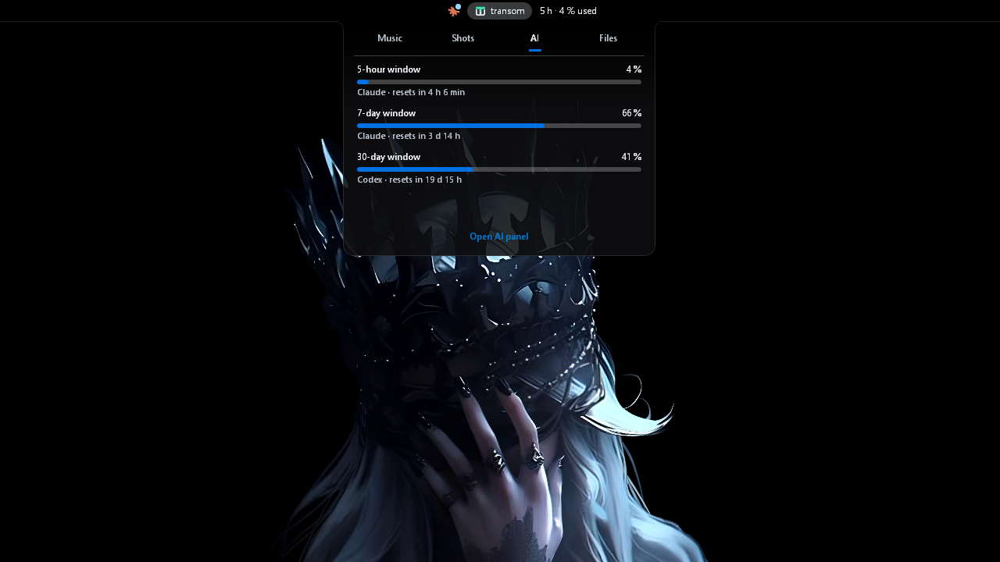
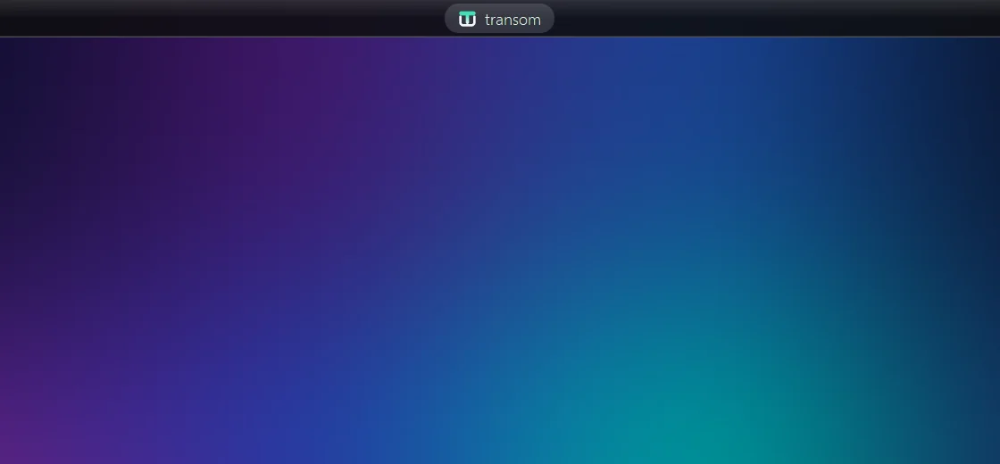
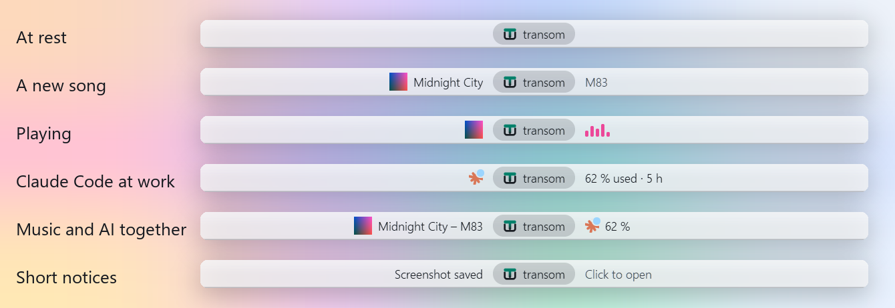
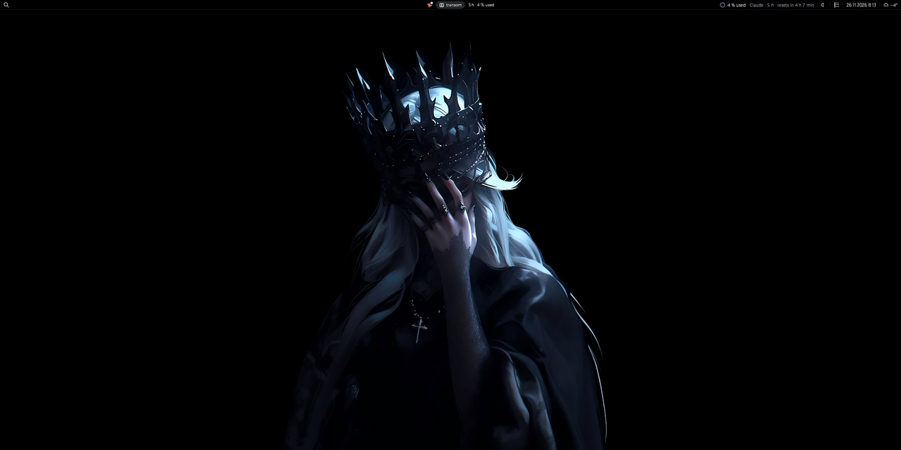
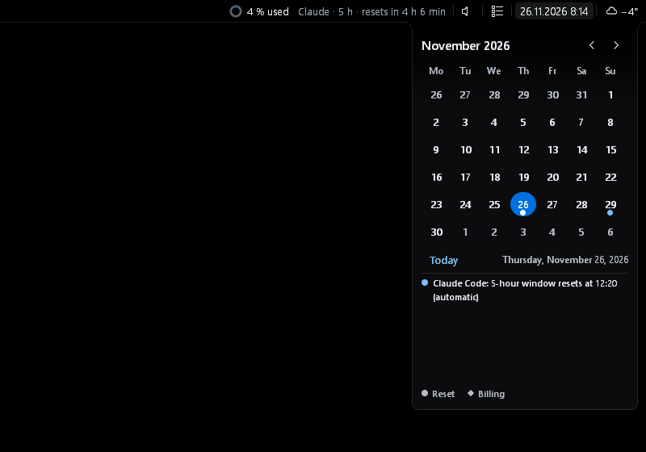
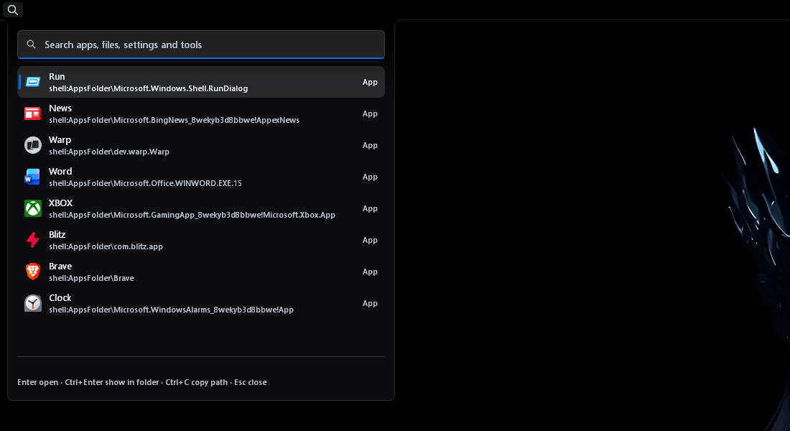
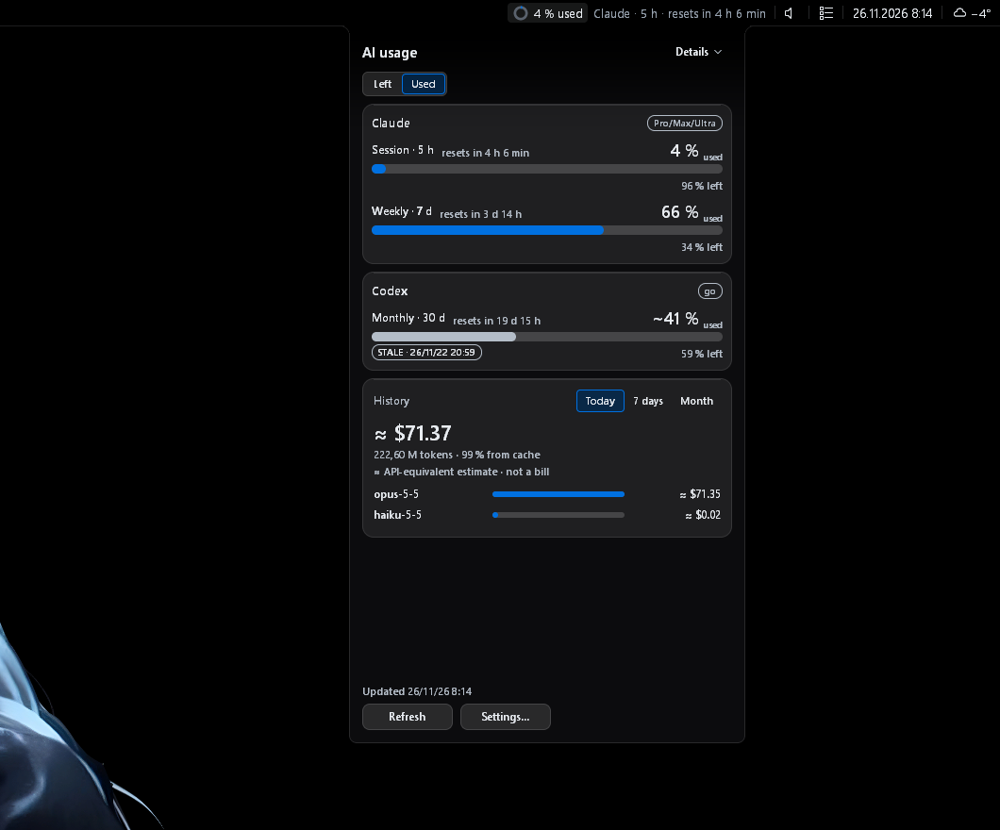
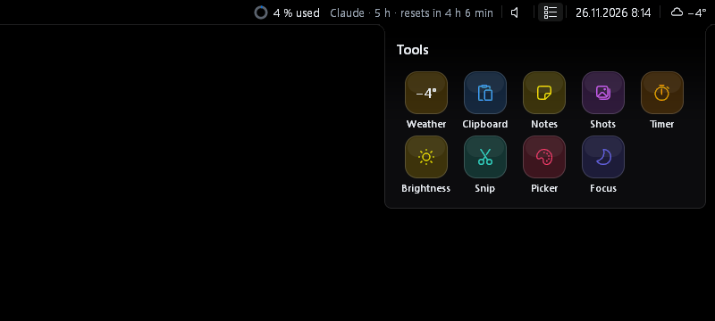

<p align="center">
  <br><br>
  <picture>
    <source media="(prefers-color-scheme: dark)" srcset="assets/brand/transom-wordmark-dark.svg">
    
  </picture>
</p>

<p align="center">
  <b>A full-width top bar for Windows 11 – with a live island in the middle.</b><br>
  Music, AI limits, calendar, search, batteries, audio and handy tools in one thin, native strip on clear black glass.
</p>

<p align="center">
  <a href="https://github.com/Antive1/transom/releases"></a>
  
  
  <a href="LICENSE"></a>
</p>

<p align="center">
  
</p>

transom is a real Windows **AppBar**: maximized windows stay below it, just like with the taskbar. It is written in Rust, draws
everything itself with GDI, starts instantly, needs no runtime and keeps your data on your PC.

> [!NOTE]
> **Early preview (alpha).** transom is developed and tested on one machine (Windows 11, build 10.0.26300). Expect rough edges and
> changes without notice. Until code signing is in place and has built reputation, Windows SmartScreen may warn before the
> first run (*More info → Run anyway*).

## The island

The middle of the bar is a small **island**. At rest it shows the transom mark; when something happens it grows to the sides and
tells you about it – right where your eyes already are.

<p align="center">
  
</p>

<picture>
  <source media="(prefers-color-scheme: dark)" srcset="assets/screenshots/island-states-dark.png">
  
</picture>

- 🎵 **Music** – a new song peeks in with its title and artist, then the cover and an equalizer that moves with the sound.
- 🤖 **AI at work** – while Claude Code or Codex is busy, the island shows its live 5-hour or weekly limit and whether the agent
  is thinking, waiting for you or done.
- 🔔 **Notices** – a screenshot taken, text copied, a timer finished or an event starting; click to open it.
- 🗂️ **Island menu** – click the island for tabs with the music player, clipboard, screenshots, AI limits and stashed files.

## Liquid glass

Panels, menus and the island menu sit on **clear black glass**: your wallpaper and windows shine through a deep tint, with a soft
sheen and a thin light rim, and panels opened from the bar flow straight out of it. The glass is drawn by transom itself (no
grey acrylic), keeps every text readable over any background and follows Windows' *Transparency effects* switch. The bar can be
glass too, or follow the Windows theme or your own colour.

<p align="center">
  
</p>

## Everything else on the bar

<table>
  <tr>
    <td width="50%"></td>
    <td width="50%"></td>
  </tr>
  <tr>
    <td width="50%"></td>
    <td width="50%"></td>
  </tr>
</table>

- 🕒 **Clock and calendar** – date, calendar popover, events from your own private ICS link (Google, Outlook).
- 🔍 **Search** – a fast, keyboard-first launcher (**Alt+Space**): apps, files from the Windows index, Settings pages, notes.
- 🔊 **Audio** – output device, system volume, per-app mixer, sound profiles, Bluetooth audio connect.
- 🎨 **Colours** – an eyedropper with a magnifier for any pixel on the screen, HEX / RGB / HSL and a colour history.
- 🔋 **Batteries** – green while charging, red when low – laptop battery plus wireless mice, keyboards, headsets and controllers (Bluetooth, Razer, Logitech, NuPhy,
  standard HID).
- 📊 **Extras** (off by default) – CPU / RAM / GPU / network, keyboard layout and Caps Lock, timer / pomodoro / stopwatch,
  monitor brightness (DDC/CI), microphone and camera in use, weather.
- 🤖 **AI usage** (opt-in) – token and cost estimates and plan limits from **local** Claude Code / Codex logs.
- 📥 **Tools** – stashed files (drop files on the island, drag them out later), clipboard history (opt-in), Quick Notes and a
  read-only Screenshots library.
- 🎨 **Looks** – light, dark or any colour, Segoe UI Variable, OLED protection (pixel shift, dimmed text, auto-hide), a
  drag-and-drop bar editor, multi-monitor, per-monitor DPI and 11 languages.

## Performance

transom is native code drawing its own pixels – no browser engine, no .NET, no Electron. Measured on the release build
(AMD Ryzen 7 9800X3D, Windows 11, one 2560 × 1440 display at 100 %, with calendar, AI usage and weather switched on):

| | |
|---|---|
| Start until the bar is on screen | **≈ 0.13 s** (124–154 ms in three runs) |
| CPU at rest | **0.0 %** – no CPU time at all in a 30-second sample; the bar only wakes up when something changes |
| Memory | **≈ 9 MB** private (≈ 35 MB working set) |
| Download | **3.5 MB** for the bar, 7.2 MB for all three programs; no runtime to install |
| Drawing the whole 2560 px bar | **≈ 0.2 ms** per frame (0.24 ms at 150 %), ≈ 37 small allocations |
| Redrawing just the island (equalizer, scrolling title) | **≈ 0.08 ms** per frame |
| CPU while rain or snow falls on the weather item | **≈ 0.6 %** of one core (12 small frames a second; off with Windows animations off) |

Animations (a scrolling title, the equalizer, panels opening) redraw only the part that moves. Not yet measured on the
running bar: CPU while music plays – from the per-frame cost above it should stay well under 1 % of one core.

Reproduce: `tools\cpu-sample.ps1 -Name transom-app -Seconds 30` for the running bar and
`cargo test --release -p transom-render --test paint_bench -- --ignored --nocapture` for the drawing cost.

## Install

1. Download **`transom-setup-<version>-x64.exe`** from the [releases](https://github.com/Antive1/transom/releases).
2. Run it. Windows may show a blue **"Windows protected your PC"** (SmartScreen) window, because the installer is not code
   signed yet and new apps have no download reputation. Click **More info → Run anyway**. The installer is built from the
   tagged source by GitHub Actions; you can check it against `SHA256SUMS.txt` in the release. It installs for your user
   only (no administrator rights) into `%LOCALAPPDATA%\Programs\transom` and can start transom with Windows.
3. On the first start a **Welcome** page asks about the basics – start with Windows, the island, glass, AI usage (Claude
   Code, Codex), weather and updates. Everything can be changed later in Settings.
4. Right-click an empty spot on the bar for the menu: **Settings**, **Customize bar**, **Hide bar**, **Quit**.

Prefer no installer? Take the **portable zip** from the same release and run `transom-app.exe`.
Uninstall from *Settings → Apps*; your settings in `%APPDATA%\transom` are kept for a later reinstall.

**Updates:** transom checks GitHub for a new release and shows a notification that says what is new; a small download icon
also appears at the right end of the bar. Click either to open the update panel with the new features and fixes from the
[changelog](CHANGELOG.md); **Update now** downloads, verifies and installs the new version and starts transom again (a portable
copy opens the release page instead). Turn the check or the icon off in *Settings → System → Updates*.

## Privacy

No telemetry, no accounts. Network access: the update check on GitHub (can be turned off), a calendar **you** connect and the
optional weather. Everything else is read locally and only for the features you switch on. Details: [PRIVACY.md](PRIVACY.md).

## Code signing policy

Releases are built from the tagged source by GitHub Actions. Code signing through [SignPath Foundation](https://signpath.org)
is being set up – see [CODE_SIGNING_POLICY.md](CODE_SIGNING_POLICY.md).

## Configuration

| What | Where |
|---|---|
| Settings | `%APPDATA%\transom\config.json` (versioned; backups in `backups\`) |
| Local data | `%LOCALAPPDATA%\transom` (stashed files, notes, clipboard history, usage cache) |
| Overrides | `TRANSOM_CONFIG` (file), `TRANSOM_DATA` (directory) |

Settings can be exported and imported from *Settings → Export and import* (an allow-listed file without secrets or paths).

Command-line flags: `--theme light|dark|system`, `--height N`, `--monitors primary`, `--log FILE`.

## Build from source

Requirements: Windows 11, Rust **1.100.0** (pinned in `rust-toolchain.toml`), MSVC Build Tools
("Desktop development with C++").

```powershell
cargo build --release
target\release\transom-app.exe
```

You get `transom-app.exe` (the bar), `transom-settings.exe` (settings window) and `transom-statusline.exe` (optional Claude Code
`statusLine` bridge). The MSVC runtime is linked statically, so no redistributable is needed.

Installer: install [Inno Setup 6](https://jrsoftware.org/isinfo.php) and run `tools\build-installer.ps1` – it writes the setup,
a portable zip and `SHA256SUMS.txt` into `dist\`.

Checks (same as CI):

```powershell
cargo fmt --all -- --check
cargo clippy --workspace --all-targets --locked -- -D warnings
cargo test --workspace --locked
cargo deny check
```

The island animation and the island states in this README are drawn by transom's own renderer from made-up data:
`TRANSOM_GALLERY=<dir> cargo test -p transom-app gallery_ -- --ignored --test-threads=1` renders every surface (the island,
glass, panels) at 100/150/200 % in both themes. The other pictures are real screenshots.

## Project layout

```text
crates/
  transom-app         the bar (AppBar host, island, items, panels)
  transom-settings    settings window
  transom-render      GDI painter, design tokens, themes, brand
  transom-platform    Win32 helpers (monitors, AppBar, DPI, glass)
  transom-config      versioned config, export/import
  transom-media       Windows media session
  transom-audio       Core Audio (device, volume)
  transom-mixer       per-app volume and output
  transom-peripherals wireless device batteries
  transom-tools       stash, clipboard, notes, screenshots
  transom-launcher    search
  transom-usage       local AI-usage estimates
  …                   core, i18n, sound, statusline
docs/                 design system and the (Slovak) development plan
installer/            Inno Setup script
assets/               logo (generated from code) and README screenshots
```

## Known limitations

- Tested on one machine and one Windows build; exclusive-fullscreen games, Explorer restarts and some multi-monitor cases are only
  partly verified.
- Screen-reader support is implemented but not yet verified with Narrator or NVDA.
- Per-app output selection uses an undocumented Windows interface (like EarTrumpet) and may break with a Windows update.
- Clipboard history is stored unencrypted on your PC (apps' "private" content is skipped).
- AI-usage numbers are estimates, not an invoice.
- Only the Slovak and English translations were reviewed by a person.

The honest per-feature verification status lives in [docs/PLAN.md](docs/PLAN.md) (Slovak).

## Contributing

Issues and pull requests are welcome – see [CONTRIBUTING.md](CONTRIBUTING.md), [SUPPORT.md](SUPPORT.md) and
[SECURITY.md](SECURITY.md). Third-party licenses: [THIRD_PARTY_NOTICES.md](THIRD_PARTY_NOTICES.md).

Windows, Segoe UI, Spotify, Claude and Codex are trademarks of their respective owners; transom is an independent project and is
not affiliated with Microsoft, Spotify, Anthropic or OpenAI.

## License

[MIT](LICENSE)
